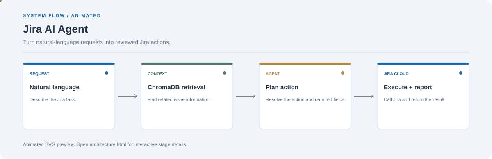

# Jira AI Agent

**Turn natural-language requests into reviewed Jira actions.**

[](https://github.com/chyk2468/Agentic-AI-JIRA)

## 1. Project Title & Tagline

Turn natural-language requests into reviewed Jira actions.

## 2. Problem Statement

Managing Jira issues can involve repeated navigation and manual entry. This project provides a natural-language interface that prepares Jira actions using relevant issue context.

## 3. Project Preview

Add a real screenshot or short GIF showing the natural-language request, review step, and final result.

[Open interactive architecture](architecture.html)

## 4. Overview

The app accepts a natural-language request, resolves the intended operation, uses the configured integration to perform supported actions, and displays the result for review.

## 5. Key Features

- Interpret a user's Jira request.
- Retrieve relevant indexed issue context.
- Route requests to supported Jira actions.
- Return the action result in the interface.

## 6. Architecture / Workflow



Open the [interactive architecture explorer](architecture.html) to select a stage and inspect its role.

## 7. Tech Stack

Python, Streamlit, Groq/Llama, Jira Cloud API, ChromaDB

## 8. Installation & Setup

```bash
git clone https://github.com/chyk2468/Agentic-AI-JIRA.git
cd Agentic-AI-JIRA
python -m venv .venv
pip install -r requirements.txt
```

## 9. Usage

Configure the Groq and Jira credentials expected by the app, then run `streamlit run app.py`. Test against a non-production Jira project and review the target issue and project before write actions.

## 10. Project Structure

- `app.py`: Streamlit interface
- `agent.py`: agent routing and reasoning
- `actions.py`: callable actions
- `jira_client.py`: Jira API wrapper
- `vector_store.py`: context retrieval

## 11. Results & Demo

Add a demo GIF showing request, action confirmation, and result. Record the supported actions and any integration errors encountered during testing.

## 12. Future Enhancements

- Add stronger action previews and confirmation.
- Add tests for project keys and issue identifiers.
- Log tool outcomes without storing secrets.
- Support more Jira workflows and fields.

## 13. License

Check the repository license before reuse. Keep Jira tokens and model keys outside source control.
