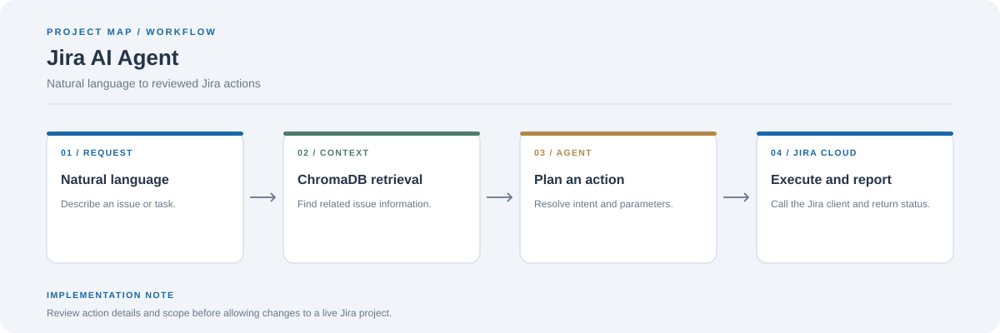

# Jira AI Agent

A Streamlit interface for managing Jira Cloud with natural-language requests. The application combines an agent workflow, Jira client functions, and ChromaDB-backed retrieval for issue context.

**Stack:** Python, Streamlit, Groq/Llama, Jira Cloud API, ChromaDB



## Workflow

1. Enter a natural-language request in the interface.
2. Retrieve relevant indexed issue context when applicable.
3. Resolve the requested Jira action and required fields.
4. Call Jira Cloud through the client module and display the result.

## Main modules

- `app.py`: user interface
- `agent.py`: agent reasoning and routing
- `actions.py`: callable actions
- `jira_client.py`: Jira API integration
- `vector_store.py`: context retrieval
- `requirements.txt`: Python dependencies

## Setup

```bash
git clone https://github.com/chyk2468/Agentic-AI-JIRA.git
cd Agentic-AI-JIRA
python -m venv .venv
```

Activate the environment, then run:

```bash
pip install -r requirements.txt
```

Set the required Groq and Jira Cloud credentials in the environment as expected by the application, then start:

```bash
streamlit run app.py
```

## Security

Keep Jira tokens and model API keys outside source control. Test on a non-production Jira project first and inspect issue identifiers, project keys, and transition details before permitting write actions.
